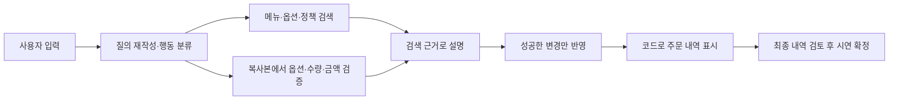

# 모키 수정본: 변경과 검증 결과

컨셉 → 데이터 → HTI → 주문 규칙 → 앱 연결 → 실제 대화 → 재검토 순으로 처리했다.
원본 팀 자료와 Google Docs는 보존하고 별도 브랜치에서 수정했다.

| 영역 | 완료한 작업 | 결과 자료 |
|---|---|---|
| 컨셉 | 테이블에서 글로 주문하는 가상 커피바, 좌석·이용 방식·시연 확정의 의미 통일 | 01_컨셉.md, README.md |
| 데이터 | 원본 v4 보존, 판매 구성/ID/금액/옵션/한영 정보 대조, 문서 61개와 저장 인덱스 일치 | scripts/validate_data.py, tests/data_validation.json |
| HTI | 사용자가 지정한 Drive 「박채원 HTI」 A~H·55개 말단 과업으로 교체, 기존 67개 질문 번호 새 연결 | 02_HTI.md, HTI_상세_구현대응.csv, tests/fixtures/chaewon_case_map.csv |
| 개발 | 복합 행동·공통 검증·부분 수정·취소·되돌리기·검토 후 확정·추가 주문·언어·회피 조건 보존 | src/, app.py, tests/ |
| 전달 | 실행 환경 고정, 시험 기록·발표 핵심 요약·시연 문안·ZIP용 소스 준비 | requirements.lock.txt, tests/results.md, 07_발표용_핵심과업과_시연.md |

## 범위 결정

1. HTI 기준은 상세 131개 안이 아닌 **박채원 HTI 현재 탭**이다. 원문 번호와 선택값을 기록하고 데이터와 다른 부분을 대응표에 명시했다.
2. 사용자가 확장안을 철회했으므로 **데이터 v4의 메뉴·선택값·정책을 유지**했다. XL·샷 +3·중국어/일본어·새 시럽·얼음 종류·쿠폰·포인트·실결제로 넓히지 않았다.
3. 외부 서비스는 연결하지 않는다. 시연은 장바구니 검토와 명시 수락 뒤 가상 주문번호를 만든다. 실제 결제·매장 접수 성공으로 설명하지 않는다.
4. 주류는 해당 손님의 직원 확인 대기까지다. 손님의 자기 신고, 옆자리 확인, 고객 화면 토글로 승인하지 않는다.

## 프로그램의 흐름

가격과 선택 가능 여부는 모델의 문장에 맡기지 않는다. 수정·확정 경로도 같은 Cart 검증을 사용한다. 조건이 모호하거나 오류가 나면 쓰기를 보류하고 주문을 보존한다.

## 데이터와 검색

엑셀 값은 변경하지 않았다. 메뉴 33·판매 구성 52·원두 3·옵션 6·정책 19·한영 메뉴 33행을 검사했다. 평가 질문 47개는 검색 문서에서 제외했다.
메뉴·원두·옵션·정책을 합친 앱 문서는 61개이며 한영 정보를 하나에 묶는다. 별도 배포용 한/영 JSONL 122개와 다른 수치다.
현재 검색 문장은 기존 벡터와 같아 재임베딩 없이 근거 메타데이터를 갱신했다. index.faiss는 보존했고 파일/데이터/문서 해시를 추가했다. 데이터나 모델이 달라지면 자동 유료 재생성 대신 불일치를 알린다.

## 검증 결과와 남은 경계

[실행 결과](../tests/results.md)에서 오프라인 검사, 실제 API, 브라우저 MOCK을 구분했다. 67개 원안 질문을 실행하고 주요 실패를 수정·재시험했다. 실제 연속 대화 14턴의 상태 self-check도 통과했다.
기존 기대문과 특정 추천 조합이 다른 Q01/Q20을 별도 표시했다. 이를 숨기고 원안 67개 전부 일치라고 보고하지 않는다.

화면을 개발 중 갱신했을 때 이전 세션의 Cart 클래스가 남아 오류가 났다. 최종 서버를 재시작하여 정상 화면을 확인했다. 주문은 세션 메모리에만 있으므로 새 배포/서버 재시작의 영속 주문 복구는 지원하지 않는다.

HTI의 모든 가지를 독립 기능으로 확대하지 않았다. 자동 업셀·자동 페어링 수락 분기, 실제 음성 청취, 실제 사용자 평가는 검증 범위 밖이다. 데이터 값은 가상 시연값이며 알레르기·의료 안전을 보장하지 않는다.

## 팀 검토 후 할 일

수정 브랜치/PR을 검토해 채택하고 발표 환경에 반영한다. 그 환경의 API/비밀번호를 설정하고 발표 담당자가 5분 시연을 리허설한다. 기존 PPT의 프로그램 구조·문서 수·HTI·시험 상태·한계를 이 문서와 맞춘다. 최종 제출 경로와 Q&A 시간은 기존 공지에서 확정되지 않은 항목이므로 팀이 확인해야 한다.

이 수정본의 코드·자료 준비와 실제 팀 채택·운영 배포·발표 리허설·과제 제출은 서로 다른 상태다.
